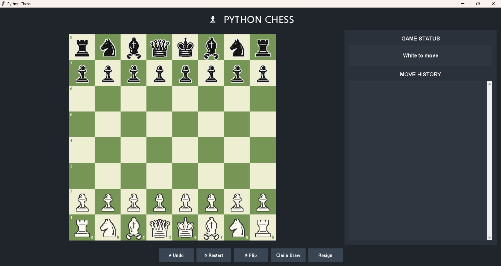

# Python Mini Projects

A growing collection of Python projects built while learning programming, GUI development, automation, and practical problem-solving.

The repository includes beginner-friendly programs as well as larger projects that use libraries such as Tkinter, OpenCV, SQLite, and FPDF.

## Repository at a glance

| Project | What it does | Folder |
|---|---|---|
| ♟️ Chess Game | Two-player desktop chess game with a graphical interface | [`chess_game/`](./chess_game/) |
| 🖼️ Image to PDF Converter | Converts image files into a PDF document | [`projects/`](./projects/) |
| 🧩 Python Mini Programs | Small programs for logic building and core Python practice | [`mini_projects/`](./mini_projects/) |
| 📸 Face Recognition Attendance System | Registers faces, recognizes them through a webcam, and records daily attendance locally | [`Face Recognition Attendance System/`](./Face%20Recognition%20Attendance%20System/) |

## Featured projects

### 1. Face Recognition Attendance System 

A local attendance-tracking prototype built with Python, OpenCV, the `face_recognition` library, and SQLite.

**Features**
- Register a student using a face photo.
- Recognize registered faces through a webcam.
- Record attendance once per student per day.
- Store student and attendance data in a local SQLite database.

[Open project folder](./Face%20Recognition%20Attendance%20System/) · [Read setup instructions](./Face%20Recognition%20Attendance%20System/README.md)

> This is a learning prototype, not a production identity-verification system. Use face images only with informed consent; do not commit personal face photos, generated face encodings, or real attendance databases.

### 2. Chess Game

A desktop chess application featuring a graphical board and two-player gameplay.



[Explore the Chess Game](./chess_game/)

### 3. Image to PDF Converter

A small utility project for converting images into PDF format.

[Explore the Image to PDF project](./projects/)

## Python mini programs

The `mini_projects/` folder currently includes:

- Electric Bill Calculator
- Number Guessing Game
- Password Generator
- Simple Calculator
- To-Do List
- Age Calculator
- Bank Balance Program
- Book Manager
- Complex Number Operator Overloading
- Employee Salary Calculator
- Hotel Management Program
- Pounds to Kilograms Converter
- Student Mark System
- Vector Operator Overloading

[Browse all mini programs](./mini_projects/)

## Getting started

### 1. Clone the repository

```bash
git clone https://github.com/Rudra0075-ms/Python_Mini_Projects.git
cd Python_Mini_Projects
```

### 2. Open a project folder

Each project is kept in its own folder. Open the folder you want to try and follow any project-specific README or requirements file.

### 3. Run a Python file

```bash
python filename.py
```

For projects with external dependencies, install the packages listed in that project's `requirements.txt`. Some projects may also require a webcam or other local resources.

## Technologies used

- Python
- Tkinter
- OpenCV
- face_recognition
- SQLite
- FPDF

## Contributing and feedback

This repository is maintained as a learning portfolio and will grow as more projects are added. Suggestions, bug reports, and improvements are welcome through GitHub Issues or Pull Requests.

---

**Note:** Project features and setup requirements may differ. Check the README inside each project folder before running it.
