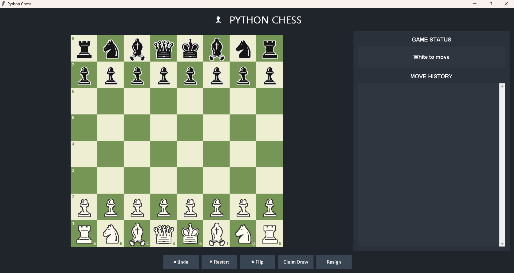

# ♟️ Python Chess Game

A desktop-based Chess Game developed using **Python, Tkinter, and python-chess**. It provides an interactive graphical interface where two players can play chess locally, follow move history, undo moves, restart the game, flip the board, claim a draw, and resign.

The application follows standard chess rules with legal move validation powered by the `python-chess` library.

---

## 📸 Application Preview



*The screenshot above shows the initial game screen, chessboard, game status panel, move history, and game controls.*

---

## ✨ Features

### ♟️ Chess Gameplay
- Complete 8×8 chessboard with alternating light and dark squares.
- Two-player local gameplay (White vs Black).
- Legal move validation.
- Automatic turn switching.
- Highlights selected squares and available legal moves.
- Highlights possible capture moves.
- Highlights the previous move.
- Indicates when a king is in check.
- Supports pawn promotion to:
  - Queen
  - Rook
  - Bishop
  - Knight

### 🎮 Game Controls
- **Undo:** Reverses the previous move.
- **Restart:** Starts a new game after confirmation.
- **Flip Board:** Changes the board orientation.
- **Claim Draw:** Allows a player to claim a draw when the rules permit it.
- **Resign:** Allows the current player to resign.

### 📋 Game Information
- Displays the current player's turn.
- Shows check status.
- Detects game-ending conditions.
- Displays the game result and termination reason.
- Maintains move history using Standard Algebraic Notation (SAN).

### 🎨 Graphical User Interface
- Built using Python Tkinter.
- Dark-themed application interface.
- Interactive chessboard using Tkinter Canvas.
- Unicode chess piece symbols.
- Resizable application window and dynamically adjusted chessboard.
- Separate game status and move history panels.

### ⌨️ Keyboard Shortcuts

| Shortcut | Action |
|---|---|
| `Ctrl + Z` | Undo move |
| `Ctrl + R` | Restart game |
| `Ctrl + F` | Flip board |
| `Esc` | Cancel current selection |

---

## 🛠️ Technologies Used

| Technology | Purpose |
|---|---|
| Python | Core programming language |
| Tkinter | Desktop GUI development |
| python-chess | Chess rules, legal moves, board state and game-ending detection |
| Tkinter Canvas | Chessboard rendering and interaction |

---

## 📂 Project Structure

```text
chess_game/
│
├── app.py
│   └── Main Python application
│
├── requirements.txt
│   └── Required Python dependencies
│
└── README.md
    └── Project documentation
```

---

## ⚙️ Installation and Setup

Follow these steps to run the project locally.

### 1. Clone the Repository

```bash
git clone https://github.com/Rudra0075-ms/Python_Mini_Projects.git
```

### 2. Navigate to the Chess Game Folder

```bash
cd Python_Mini_Projects/chess_game
```

### 3. Create a Virtual Environment (Recommended)

```bash
python -m venv venv
```

Activate the environment:

**Windows (PowerShell):**

```powershell
.\venv\Scripts\Activate.ps1
```

**Windows (Command Prompt):**

```cmd
venv\Scripts\activate
```

**Linux / macOS:**

```bash
source venv/bin/activate
```

### 4. Install Dependencies

```bash
python -m pip install -r requirements.txt
```

### 5. Run the Application

```bash
python app.py
```

The Python Chess desktop application should now open.

---

## 📦 Dependencies

The project uses the following external Python package:

**requirements.txt**

```text
python-chess>=1.999
```

**Note:** Tkinter is included with many standard Python installations. On some Linux distributions, it may need to be installed separately.

---

## ♜ Chess Rules and Game Validation

The application uses the `python-chess` library to manage chess logic and enforce legal moves.

It supports standard chess rules, including:

- Check and checkmate.
- Stalemate.
- Castling.
- En passant.
- Pawn promotion.
- Insufficient material.
- Automatic detection of game-ending conditions.
- Draw claims when eligible.

The chessboard only accepts moves considered legal by the chess rules engine.

---

## 🚀 How to Play

1. Launch the application using `python app.py`.
2. White makes the first move.
3. Click on a piece to select it.
4. Available legal moves will be highlighted.
5. Click on a highlighted square to complete the move.
6. Players take turns until the game ends.
7. Use the control buttons to undo, restart, flip the board, claim a draw, or resign.

---

## 🎯 Project Objectives

This project was developed to explore practical Python desktop application development.

Key learning objectives include:

- Building graphical applications using Tkinter.
- Implementing interactive board-based interfaces.
- Working with external Python libraries.
- Managing application state and user interactions.
- Understanding chess rules and legal move validation.
- Handling events, callbacks, and keyboard shortcuts.
- Organizing a Python application into manageable components.

---

## 🔮 Future Improvements

Potential features for future versions:

- Single-player mode against a computer opponent.
- Adjustable AI difficulty.
- Save and load chess games.
- Import and export games using PGN.
- Chess clocks and timed matches.
- Player profiles and match statistics.
- Sound effects and additional themes.

---

## 🤝 Contributing

Contributions, suggestions, and improvements are welcome.

1. Fork this repository.
2. Create a new feature branch.
3. Make your changes.
4. Commit your changes.
5. Submit a pull request.

---

## 👨‍💻 Author

**Madhab**

GitHub: [@Rudra0075-ms](https://github.com/Rudra0075-ms)

Project Repository: [Python Mini Projects](https://github.com/Rudra0075-ms/Python_Mini_Projects)

---

## 📄 License

This project is available for educational and learning purposes.

If you plan to distribute or modify it, consider adding an explicit open-source license.

---

<p align="center">
  Made with ❤️ using Python
</p>
